# Market impact in the limit order book: TSLA, 2019

How far does the price move when someone trades, and how does that answer change when many trades are aggregated? This project measures price impact on one year of Tesla order-book data, tests the universal scaling law of Patzelt & Bouchaud, estimates Kyle's lambda, and benchmarks 13 regression models on the impact function.


| Aggregate impact for five horizons | The same curves after rescaling |
|:---:|:---:|
| 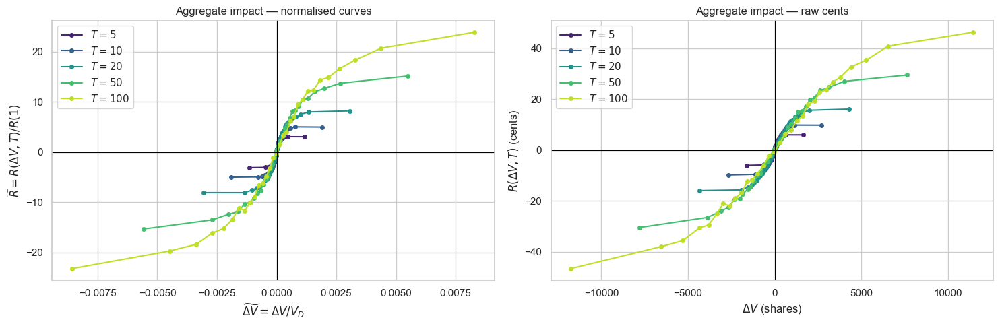 | 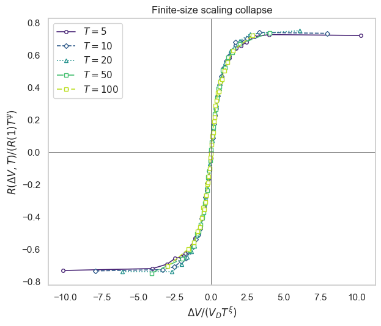 |

Once rescaled by two exponents, the impact curves measured over 5 to 100 consecutive market orders fall on a single sigmoid. That collapse is the central result of the project.

## Results at a glance

| | |
|---|---|
| **Sample** | 252 trading days, 38.7 million order-book messages, 4.57 million reconstructed market orders |
| **Spread** | 8.0 cents on average (median 7), at one tick only 5% of the time: a small-tick stock |
| **Lag-1 impact** | $R(1)$ = 1.87 cents, proportional to the spread at every time scale ($R^2$ from 0.81 to 0.87) |
| **Scaling exponents** | $\xi$ = 1.08 and $\psi$ = 0.69 fitted on five horizons |
| **Kyle's lambda** | 0.024 cents per share at $T$ = 5, down to 0.009 at $T$ = 100 |
| **Impact model** | Out-of-sample $R^2$ of 0.24 (linear) → 0.32 (concave form) → 0.38 (adding order-flow imbalance) |

## Data

The analysis uses [LOBSTER](https://lobsterdata.com) level-2 data for TSLA over the full year 2019: one `message` file and one `orderbook` file per trading day. Only visible executions (event type 4) are used in sections 1 to 8 of the notebook; section 9 adds hidden executions (type 5).

LOBSTER data is licensed, so no raw file is stored in this repository. See [Reproduce](#reproduce) for the expected layout.

## Pipeline

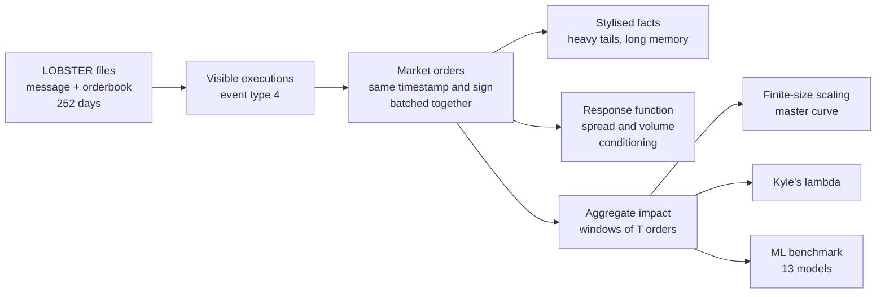

A market order that consumes several resting limit orders appears as several rows with the same timestamp. These rows are batched back into one order, which takes the sample from 6.50 million executions to 4.57 million market orders. Daily boundaries are never crossed when computing returns or windows.

## What the analysis shows

### 1. The order book and its stylised facts

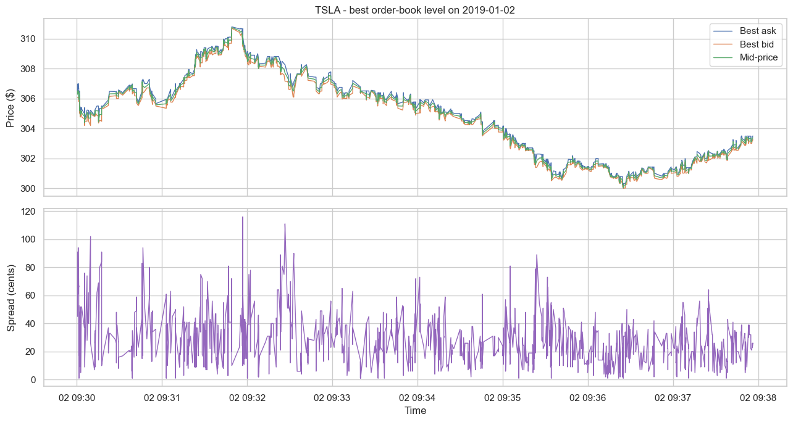

Returns measured trade by trade are far from Gaussian. On the first 20 trading days, excess kurtosis is 9.8 at one trade, 3.1 over 10 trades and 1.7 over 100 trades, and the tail exponent estimated by maximum likelihood rises from 3.2 to 4.2 over the same horizons. Returns therefore become more Gaussian as they are aggregated, without getting all the way there.

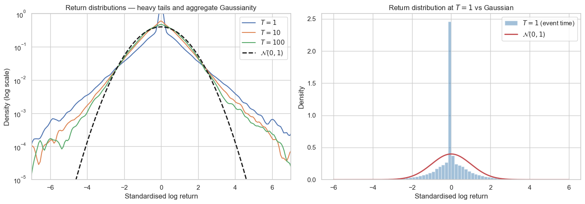

Order signs have long memory. On the same sample, their autocorrelation is 0.54 at lag 1 and still 0.03 at lag 50: a buy is likely to be followed by more buys for a long time, which is the signature of large orders being split.

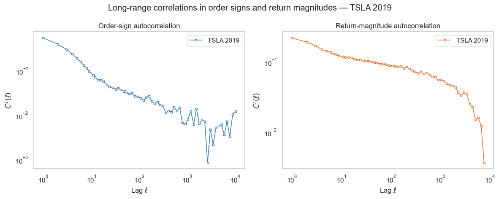

### 2. Impact and the spread

The response function measures the average price move in the direction of a trade:

```math
R(\ell) = \left\langle \varepsilon_t \, (m_{t+\ell} - m_t) \right\rangle
```

where $\varepsilon_t$ is the sign of the market order and $m_t$ the mid-price. With a single stock the usual cross-sectional test is impossible, so the notebook tests the relation through time: when TSLA trades with a wider spread, is its impact higher? The answer is yes, with a slope between 0.23 and 0.27 at daily, weekly, monthly and intraday scales. This fits the adverse-selection argument: market makers quote a spread that pays for the impact of the orders they face.

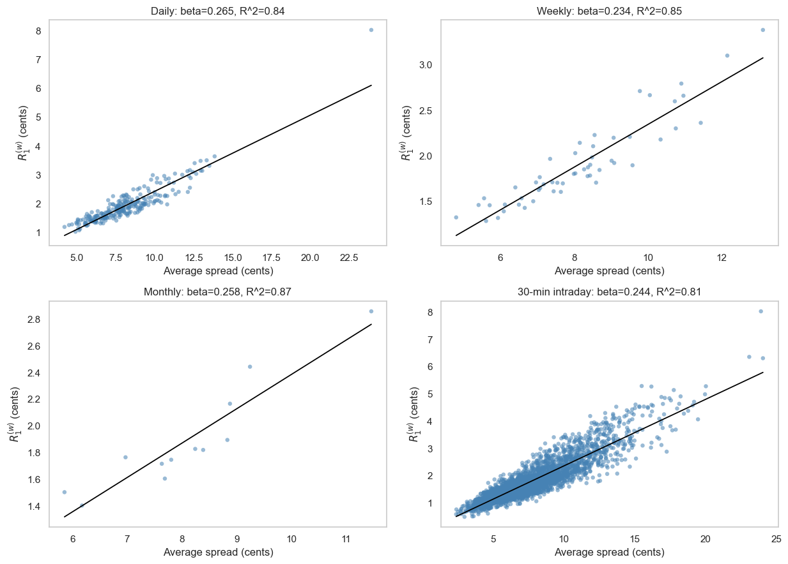

Once volatility, visible depth and time of day are added as controls in the intraday regressions, the spread coefficient turns slightly negative (−0.07). The raw relation therefore reflects a common liquidity state more than an effect of the spread taken alone.

Conditioned on its own size, a single order barely moves the price more when it is larger: the fitted exponent is $\zeta$ = 0.06. Large orders are sent when the book can absorb them.

### 3. Aggregate impact and finite-size scaling

Over a window of $T$ consecutive market orders, the signed volume imbalance is $\Delta V = \sum \varepsilon_n v_n$ and the aggregate impact is the mean price change given that imbalance. Patzelt & Bouchaud propose a scaling form:

```math
R(\Delta V, T) \approx R(1) \, T^{\psi} \, \mathcal{F}\left(\frac{\Delta V}{V_D \, T^{\xi}}\right),
\qquad
\mathcal{F}(x) = \frac{x}{\left(1 + |x|^{\alpha}\right)^{\beta/\alpha}}
```

Fitting the five horizons jointly gives $\xi$ = 1.08, $\psi$ = 0.69, $\alpha$ = 1.23 and $\beta$ = 1.11, and the rescaled curves collapse as shown at the top of this page. Impact is linear for small imbalances and saturates for large ones.

Section 9 of the notebook repeats the exercise in the paper's own setting, with 28 horizons and hidden executions included (5.88 million transactions). It finds $\xi$ = 0.98 ± 0.01 and $\psi$ = 0.66 ± 0.01, and Hurst exponents of 0.69 for order signs and 0.51 for returns: order flow is persistent, yet prices stay close to diffusive.

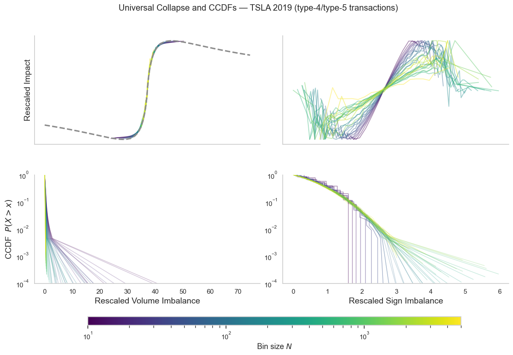

### 4. Kyle's lambda

Kyle's lambda is the slope of the impact curve near zero imbalance, that is the price move per share of net order flow. It is estimated by least squares on the central 35% of the imbalance distribution. It decays as a power of the horizon: the exponent is 0.32 when fitted directly and 0.40 when predicted from the scaling exponents ($\xi - \psi$). The two estimates differ, and the notebook reports both.

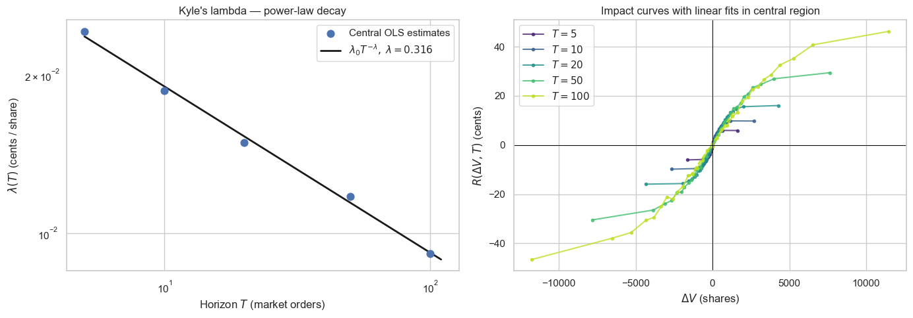

### 5. Machine learning on the impact function

The task is to predict the impact of a 10-order window, in cents, from its imbalance. Three choices keep the evaluation honest:

- **Raw windows, not bin averages.** The model is fitted on 412,849 individual windows. On this data the correlation between imbalance and impact is 0.50 on raw windows and 0.89 once averaged in 80 bins, which explains the 0.85 reported in the reference thesis.
- **Temporal split.** Training runs from 2 January to 21 October, testing from 22 October to 31 December.
- **Day-grouped cross-validation.** The 10 folds never put windows from the same day on both sides.

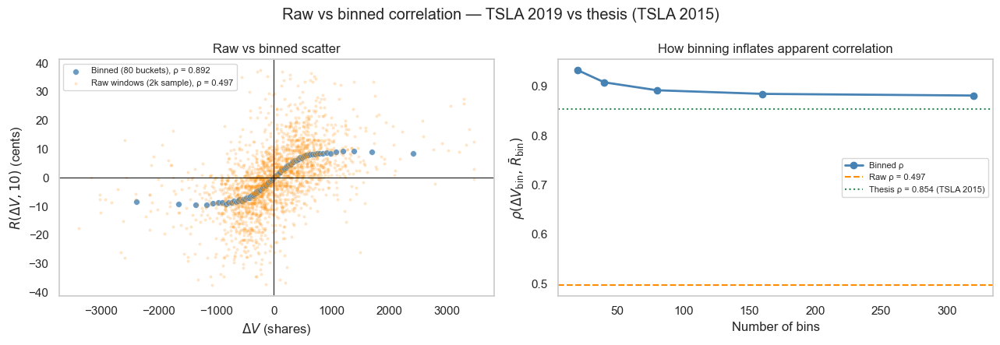

| Model | Features | Test MSE (cents²) | Test $R^2$ | Sign accuracy |
|---|---|---:|---:|---:|
| Linear regression | $\Delta V$ | 107.07 | 0.242 | 76.6% |
| Linear regression + concave transforms | $\Delta V$, abs, signed sqrt, signed log | 95.76 | 0.322 | 76.5% |
| Gradient boosting | $\Delta V$ | 95.72 | 0.322 | 76.6% |
| Ridge + concave transforms + order-flow imbalance | $\Delta V$ and $\Delta E$ with transforms | **87.32** | **0.382** | **78.2%** |

Two lessons come out of the benchmark:

1. **The functional form matters more than the model class.** A linear regression given concave transforms of the imbalance matches gradient boosting and random forests. The 10.6% gain over plain least squares comes from the concavity of impact, which trees merely rediscover.
2. **A second feature matters more than a bigger model.** Adding the order-flow imbalance $\Delta E = \sum \varepsilon_n$, the signed count of orders, cuts the test error by 18.5% relative to plain least squares, with a linear model. The number of orders on each side carries information that volume alone does not.

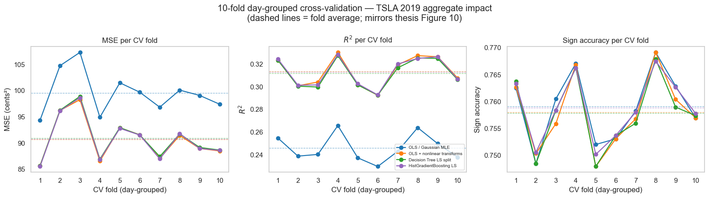

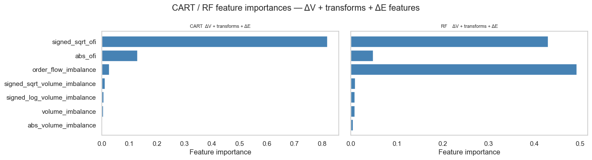

### 6. Sticky prices

Section 9.4 of the notebook reproduces the paper's view of the book around trades: the mid-price in black, displayed ask liquidity in red and bid liquidity in blue, with the rolling order-sign imbalance below.

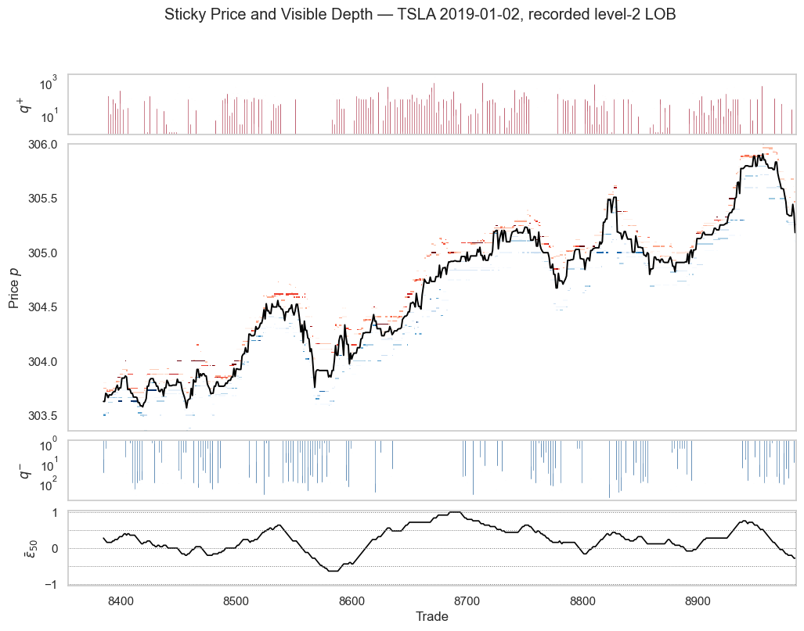

## Limits

- **One stock, one year.** The universality claim of the paper is about many instruments. This project only checks that TSLA in 2019 is consistent with it.
- **Two book levels.** The LOBSTER files hold the two best levels on each side, so depth beyond them is unobserved.
- **Explanatory, not predictive.** The regression uses the imbalance of a window to explain the price change over that same window. It models the impact function. It is not a trading signal and nothing here is backtested.
- **Low $R^2$ is expected.** Most of the variance of a 10-order price change does not depend on imbalance, which is why results on raw windows look weaker than published bin-averaged ones.

## Reproduce

```bash
cd projects/tsla-market-impact
python3 -m venv .venv && source .venv/bin/activate
pip install -r requirements.txt
```

Then place the LOBSTER level-2 files in a `TSLA/` folder at the root of this project, named as LOBSTER delivers them:

```
TSLA/TSLA_2019-01-02_34200000_57600000_message_2.csv
TSLA/TSLA_2019-01-02_34200000_57600000_orderbook_2.csv
...
```

and run [`notebooks/tsla_liquidity_analysis.ipynb`](notebooks/tsla_liquidity_analysis.ipynb) from top to bottom. The notebook copies the raw files to a working folder next to the project and caches the prepared data there as Parquet; both are git-ignored. Set `RUN_ML = False` in the first code cell to skip the slow machine-learning section.

The figures in this README are the outputs stored in the committed notebook. If GitHub struggles to render the notebook (it is 4 MB), open it in [nbviewer](https://nbviewer.org/github/Remisitk/quant-ml-portfolio/blob/main/projects/tsla-market-impact/notebooks/tsla_liquidity_analysis.ipynb).

## Layout

```
tsla-market-impact/
├── notebooks/tsla_liquidity_analysis.ipynb   # the full analysis, executed
├── figures/                                  # key figures exported from the notebook
├── requirements.txt
└── README.md
```

## Team and credits

This is a team project, carried out in one week in June 2026 for the course *Liquidity Games in HFT Markets* taught by Anastasia Bugaenko at CentraleSupélec.

**Team:** Laura Cohen, Riad Darwish, Allan Pariente and Rémi Sithisak.

The team's working repository, with its full commit history, is [lauracoh10-collab/EI_liquidity](https://github.com/lauracoh10-collab/EI_liquidity). This folder is a curated copy for presentation: the notebook is the team's, and the README, the exported figures and the tidy-up of the notebook notes were added here. The course slides and the course reference notebook are not redistributed.

## References

- F. Patzelt and J.-P. Bouchaud, *Universal scaling and nonlinearity of aggregate price impact in financial markets*, Physical Review E 97, 012304 (2018). [arXiv:1706.04163](https://arxiv.org/abs/1706.04163)
- A. S. Kyle, *Continuous auctions and insider trading*, Econometrica 53(6), 1985.
- J.-P. Bouchaud, Y. Gefen, M. Potters and M. Wyart, *Fluctuations and response in financial markets: the subtle nature of "random" price changes*, Quantitative Finance 4(2), 2004.
- R. Cont, *Empirical properties of asset returns: stylized facts and statistical issues*, Quantitative Finance 1(2), 2001.
- M. D. Gould, M. A. Porter, S. Williams, M. McDonald, D. J. Fenn and S. D. Howison, *Limit order books*, Quantitative Finance 13(11), 2013.
- A. Bugaenko, *Empirical Study of Market Impact*, master's thesis.
- R. Huang and T. Polak, *LOBSTER: Limit Order Book Reconstruction System*, 2011.
